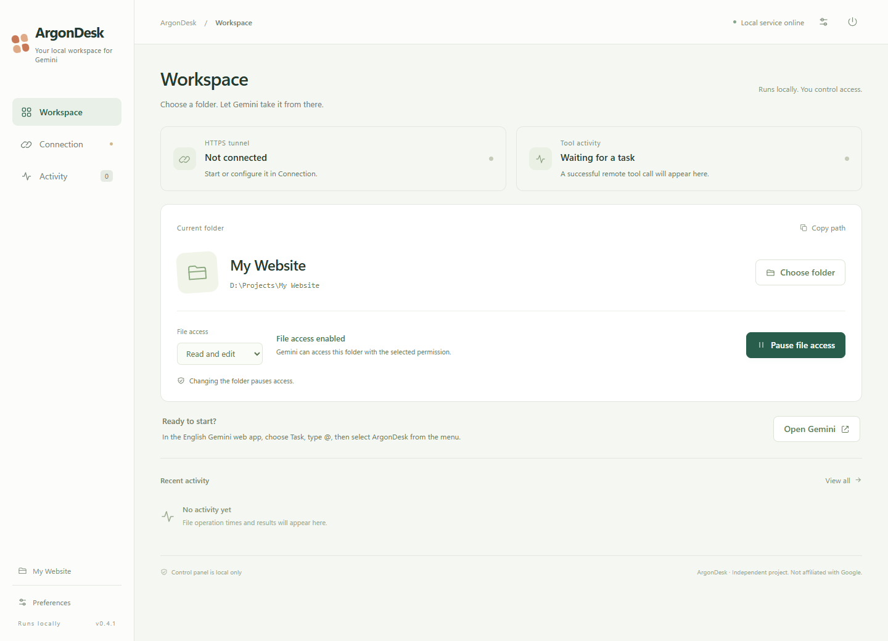

# ArgonDesk — let Gemini Web work in a local folder

[简体中文](README.zh-CN.md) · English · Preview 0.4.2 · [MIT](LICENSE)

[Download Windows / source packages](https://github.com/nexora-dev9/ArgonDesk/releases) · [Usage, thinking and animation](docs/USAGE.md)

Choose a folder on Windows, connect ArgonDesk as a custom MCP app in the **Gemini website**, and ask Gemini to read, create or edit files there. Use your existing eligible Gemini web account; no Gemini model API key or separate model API billing is required.

This is for people searching for **Gemini web local file access**, **Gemini website MCP filesystem**, or **a local workspace for browser-based Gemini coding**. It brings the file editing part of an agent workspace to your web conversation. It currently exposes six text-file tools; it does not run terminal commands or replace a full IDE such as Antigravity.

ArgonDesk is an independent Windows preview, not an official Google product. ArgonDesk is the project name. Its tool server is not tied to a particular model codename.

## Documentation

| Guide | What it covers |
| --- | --- |
| [First installation](docs/SETUP.md) | Download or source build, account prerequisites, first native tool call |
| [Network and tunnel choices](docs/NETWORKING.md) | ngrok, TUN, Cloudflare and other options, current support boundaries |
| [Troubleshooting](docs/TROUBLESHOOTING.md) | Allow, app selection, black code blocks, connecting, quotas and scope errors |
| [Usage and creative quality](docs/USAGE.md) | Fewer unnecessary calls, animated SVGs, thinking settings and two usage limits |
| [AI-assisted setup](docs/AI_SETUP.md) | A shareable prompt and verifiable instructions for another coding agent |
| [Security](SECURITY.md) | Folder authority, data flow and credentials |
| [Contributing](CONTRIBUTING.md) | Development, focused changes and checks |
| [Validation and roadmap](docs/ROADMAP.md) | What is tested and what remains planned |

## How it works

Gemini website → Google's native custom MCP app → your private HTTPS endpoint → ngrok → ArgonDesk on localhost → your selected folder.

The control panel stays at http://127.0.0.1:3008/ and is not forwarded publicly. This loopback address means the reader's own PC, running its own copy of ArgonDesk; 3008 is the default port. No browser extension, long Insert prompt or green automation overlay is needed. The web page handles native tool requests and results; ArgonDesk does not automatically type extra prompts into your conversation.

There are three pages:
- **Workspace:** tunnel status, actual remote tool activity, folder selection, read/edit permission and pause.
- **Connection:** your account settings, private MCP URL, setup instructions, traffic counters, diagnostics and connection key rotation.
- **Activity:** the last 100 file-tool results, including denied requests.

Open **Preferences** using the gear button to switch between English and Simplified Chinese. This also changes the Windows tray and folder dialog labels. It does not change the Gemini website language.

## Install on Windows

The current target is Windows 10/11 x64 with Microsoft Edge, Windows PowerShell 5.1 and .NET Framework 4.x.

**Windows package:** fully extract the Windows x64 ZIP into a writable folder, then open `Start-ArgonDesk.cmd`. On first launch it downloads the official ngrok client and verifies its signature before opening the app. After setup, you can use `ArgonDesk.exe` or a shortcut. Keep the folder contents together. The package includes Node.js and runtime dependencies; it does not redistribute ngrok. The desktop entry is currently unsigned.

**Source package:**
1. Install [Node.js](https://nodejs.org/) 22 or newer.
2. Open PowerShell in the extracted source folder.
3. Run `.\Setup.ps1` to install locked npm dependencies and download the official ngrok client. Its Authenticode signature is checked.
4. Run `.\Build.ps1` to compile `ArgonDesk.exe`.
5. Open `Start-ArgonDesk.cmd`. The Chinese alias `打开Gemini工作台.cmd` does the same. Without a C# build, it starts the PowerShell entry.

If PowerShell blocks scripts, review the script and follow your Windows administrator's execution policy. No system service or automatic startup task is installed. First launch creates an empty internal workspace in read-only, paused mode.

## Connect your own Gemini account

You need access to Google's **custom Connected Apps** feature. Google's current help page lists personal-account, age, location, Keep Activity and English-interface requirements; verify eligibility for your account on the [official page](https://support.google.com/gemini/answer/17209137). A paid web subscription alone does not guarantee that every account has this feature.

1. Create your own [ngrok account](https://dashboard.ngrok.com/signup). Get its assigned HTTPS development domain and Authtoken.
2. In **Connection**, enter the domain and token, save, then start the tunnel. An empty token field preserves an already saved token.
3. Once the tunnel is online, copy the **private connection URL** from ArgonDesk.
4. Open [Gemini Connected Apps](https://gemini.google.com/customize/connectors?hl=en). Add a custom app using that URL and give it a name such as **ArgonDesk**. Follow Google's current setup screens.
5. Refresh Gemini. Its app details should expose exactly six tools.
6. In ArgonDesk, choose the folder, select **Read only** or **Read and edit**, then enable file access.

Optionally enable **Connect when ArgonDesk opens** to restore the tunnel. Separately, **Preferences → Enable file access on startup** opts into enabling the saved folder and permission on every backend start. It is off for new and existing installations until chosen. Turning it on does not enable the current session; a manual pause lasts until restart when this option is on. Missing or replaced roots stay paused.

The URL contains a random capability key. Treat the complete URL as a password. This preview does not implement Google-account-bound OAuth. Token storage uses DPAPI for the current Windows user; do not migrate its ciphertext to another computer.

## Daily workflow and Allow confirmations

The previously verified website workflow was **English interface → Task → Argon → select the custom app**. This is a record of a tested path, not a claim that only this model can work. Google's UI and model availability can change. Ordinary Chat did not initiate tool calls in that check.

1. Open ArgonDesk, choose a folder and enable the required permission.
2. Open a fresh Gemini task. Type `@` and **select your app from the menu**. There is no need to spell the name manually; use the name you registered.
3. Ask: “Inspect the current workspace, create a Chinese webpage there and save it as index.html.”
4. Review Google's **Allow / Deny** card when a write is proposed. Click **Allow** to approve it.
5. Check **Activity** and the actual file result.

**Google currently requires manual confirmation for write actions. ArgonDesk does not remove or auto-click those confirmations.** A complex task may ask more than once. Batch edits can reduce the number of tool calls when the model uses them, but do not remove Google's confirmation requirement.

Switching folders or changing read/edit permission pauses access and rotates the workspace ID. Old requests using the previous ID fail. Restarting also rotates the ID and stays paused unless startup file access is enabled. The private connection URL stays the same across these changes, so you do not need to register the app again.

A black code block containing `function_call_start` or `desktop-commander.read_file` is just text unless another extension actually executes it. Start a new conversation if an old one contains the previous Insert instructions. A successful MCP handshake or tool listing also does not prove a file was read. ArgonDesk distinguishes tunnel reachability from **successful remote tool activity**.

Closing the panel leaves the backend in the Windows tray. Use the power button or **Stop service and quit** to stop the backend and tunnel. Reopening reuses a healthy existing backend.

## Tools and folder boundaries

| Tool | Behavior |
| --- | --- |
| workspace_info | Get the selected folder, current workspace ID, permission and pause state |
| list_files | List up to 500 entries in a directory |
| read_file | Read 1–1000 lines per request, default 200 |
| write_file | Create without overwrite (`mode=create`), rewrite or append UTF-8 text; creates missing parent folders |
| edit_file | Apply a unique replacement, or up to 50 replacements to one file |
| create_directory | Create a folder within the workspace |

Files are limited to 2 MiB. This preview targets ordinary UTF-8 text, not arbitrary binary files. There are no shell, browser-control, delete, move or permission-management tools.

The server enforces the selected root, workspace ID, paused state and read/edit permission. It rejects absolute paths, parent traversal, NTFS alternate streams, device names, trailing aliases, symbolic links, junctions and hard links. Replacing the selected root with a junction is also rejected.

This is a file-tool boundary, not a change to Windows account permissions or a complete operating-system sandbox. Programs you manually execute retain their own Windows permissions. The implementation is not a guarantee against concurrent filesystem tampering by other local processes.

Requested file contents travel through ngrok to Google. The random URL must remain private. Local history stores tool names, workspace paths, timestamps and success/failure, not file contents. Older records may lack a workspace path. Tunnel diagnostics store a short list of event categories and error codes, without raw agent logs or tokens.

## Fewer requests

In 0.4.2, a simple new artifact can use **workspace_info → write_file(mode=create)**. Create-only writes refuse collisions, so inspecting unrelated files first is unnecessary. Short MCP guidance identifies ArgonDesk as the file connection and asks the model to preserve detail, real animation and interactivity. Successful tool results now return one canonical JSON text payload, without a second structured copy of file contents. Clients should parse `content[0].text`.

A controlled local 24,447-byte read produced 60,917 bytes of tool-result JSON in 0.4.1 and 33,384 in 0.4.2, about 45% less. This measures response bytes, **not Google compute savings**. Model choices, Task reasoning, caching and Google's accounting remain outside ArgonDesk's control. New guidance does not prove improved visual quality; check the artifact. See the [usage and animation guide](docs/USAGE.md).

Version 0.4.1 lets `edit_file` accept an `edits` array. All replacements must match uniquely, in order, before any write occurs. A later mismatch leaves the original file unchanged. The previous `old_text` / `new_text` format still works; do not mix formats.

Example task instruction:
> Read the relevant section once. Plan the changes and submit related replacements in the same file using one edit_file edits array. Read back the changed area once.

This reduces requests only when Gemini follows the batching pattern. It does not reduce the size of necessary file data, combine edits across files or guarantee a particular cost saving. UI polling is local; version 0.4.1 pauses it while the panel is hidden. It does not perform recurring public connectivity probes.

## Network, TUN and quotas

**TUN is not a universal requirement for ngrok or ArgonDesk.** Use ordinary routing if it reaches ngrok reliably. A browser's proxy or residential exit does not automatically apply to a separate ngrok process. Some ngrok account plans reject an explicitly configured client proxy.

Where normal routing fails, a virtual network adapter (TUN) with process-based rules is one possible solution. TUN intercepts traffic; the active rules decide whether each connection uses a proxy or goes direct. It does not inherently mean all traffic is proxied. For example, a manually reviewed setup can route only this application's ngrok process through a reachable exit while domestic traffic stays direct.

ArgonDesk does not change Clash, system routes, proxies or DNS. No personal proxy rules are included. If you ask a coding assistant to help with routing, have it inspect the current configuration, back up changes and verify both ngrok and unrelated browsing. Moving the software folder may invalidate an exact process-path rule.

ngrok plan quotas and Google model quotas are separate. Check [ngrok usage](https://dashboard.ngrok.com/usage) and [current limits](https://ngrok.com/docs/pricing-limits/free-plan-limits). App counters cover this run's public requests and response bytes; they are not the provider's monthly bill. A tool action can involve multiple protocol requests. ArgonDesk cannot reset either provider's quota.

## Troubleshooting

- **Connecting with an error:** inspect Connection → Advanced. In 0.4.1, session recovery and successful public responses clear stale errors; an unrelated upstream request failure no longer marks the entire tunnel offline. A persistent error may still mean a real network, domain or account problem.
- **Online but no files change:** confirm file access is enabled, select the native app in a fresh task, approve writes and check Activity. “Waiting for a task” is expected until a successful public tool call occurs.
- **Folder picker hidden:** 0.4.1 gives the dialog a temporary topmost owner; only the picker interaction is affected. The revised behavior was manually confirmed on the current Windows installation; other desktop environments still need testing.
- **Old URL stops working:** connection key rotation intentionally invalidates it, pauses access and stops the tunnel. Add the new URL in Gemini.
- **After an update:** reload the panel or close and reopen it. Keep the installation folder fixed if routing rules depend on its path.

## Development and verification

`npm test` checks folder boundaries and real MCP tool calls in an isolated fixture. It includes batch success/failure and language preference persistence. `node tests/tunnel.mjs` checks domain validation and DPAPI. `node tests/tunnel-lifecycle.mjs` uses a mock client to check startup, cancellation, recovery and cleanup without external networking.

`Pack.ps1` creates source and Windows portable ZIPs from an explicit allowlist. It excludes `.local/state`, personal credentials, connection keys, histories, logs and work files, and checks the archives for current private configuration markers. Keep runtime data out of Git; never upload an already-used installation folder wholesale.

The 0.4.1 browser checks cover both languages, all three pages and four viewport widths. New Gemini messages were not sent during those checks. Earlier website read/approve/write/read-back success is historical evidence, not a new end-to-end model test for every release. Another Windows computer and long-running network stability remain unverified.

## Related projects and release status

[MCP SuperAssistant](https://github.com/srbhptl39/MCP-SuperAssistant) already connects Gemini's website to MCP tools through a browser extension. [Web AI Local MCP Bridge](https://github.com/beavtye/web-ai-local-mcp-bridge) offers templates for browser AI and local files. Their existence rules out a broad “first ever Gemini web-to-local tools” claim; we have not independently tested their deployments.

ArgonDesk's current focus is **native Gemini custom MCP + a Windows folder permission panel + bilingual UI + no model API setup**. WebCodex's conversation-to-workspace workflow inspired the product idea. No source code or branding from those projects was copied.

ArgonDesk is an open-source preview under the [MIT License](LICENSE), with ongoing development. Third-party software retains its own licenses and terms; see [notices](THIRD_PARTY_NOTICES.md). Another PC, long-running connectivity and additional tunnel providers remain future validation work. See the [roadmap](docs/ROADMAP.md).
