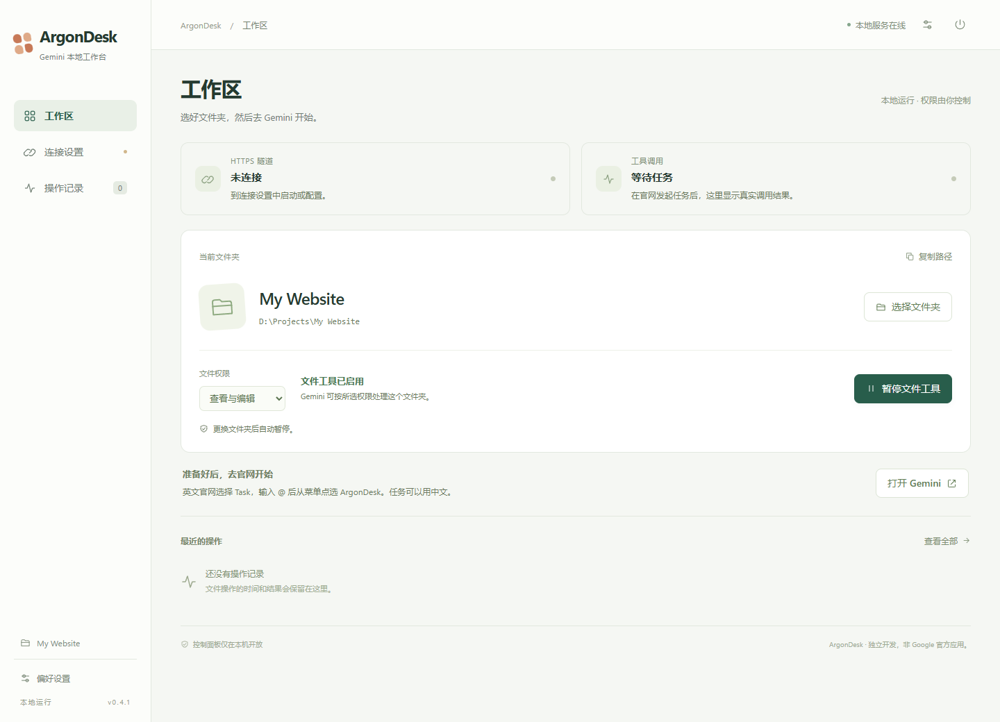

# ArgonDesk — 让 Gemini 官网读写你选择的本地文件夹

简体中文 · [English](README.md) · 预览版 0.4.2 · [MIT 许可证](LICENSE)

[下载 Windows 包或源码包](https://github.com/nexora-dev9/ArgonDesk/releases) · [额度、思考与动画说明](docs/USAGE.zh-CN.md)

在 Windows 中选择一个文件夹，把 ArgonDesk 作为原生 MCP 自定义应用接到 **Gemini 官网**，然后直接在网页对话里让 Gemini 读取、创建和编辑里面的文件。使用已有且具备该功能的官网账户，不需要 Gemini 模型 API Key，也不产生另一个模型 API 账单。

如果你正在寻找“**Gemini 网页版修改本地文件**”“**Gemini 官网连接本地文件夹**”“**Gemini MCP 本地工作区**”或“让 Gemini 网页对话像编程智能体一样落盘写代码”，本项目提供这条工作路径。目前支持六项文本文件工具，适合网页、代码和文档编辑；没有终端执行功能，也不等同于完整的 Antigravity 或 IDE。

这是独立开发的 Windows 预览软件，并非 Google 官方产品。项目正式命名为 ArgonDesk；服务本身不绑定某一个模型代号。

## 说明文档

| 文档 | 解决的问题 |
| --- | --- |
| [从零安装与接入](docs/SETUP.zh-CN.md) | 下载或源码安装、账号条件、第一次真实工具调用 |
| [网络与隧道选择](docs/NETWORKING.zh-CN.md) | ngrok、TUN、Cloudflare 等方案和当前支持范围 |
| [排错手册](docs/TROUBLESHOOTING.zh-CN.md) | Allow、应用选择、黑色代码块、connecting、额度和目录错误 |
| [额度与创作质量](docs/USAGE.zh-CN.md) | 减少多余调用、动效 SVG、思考等级和两层额度 |
| [让其他智能体帮你安装](docs/AI_SETUP.zh-CN.md) | 可直接转交的提示词、操作边界和验证要求 |
| [安全说明](SECURITY.md) | 文件夹权限、数据流与凭据 |
| [参与开发](CONTRIBUTING.zh-CN.md) | 本地开发、精确改动与检查 |
| [验证状态与路线图](docs/ROADMAP.zh-CN.md) | 已验证与后续计划 |

## 工作方式

Gemini 官网 → Google 原生自定义 MCP 应用 → 你的私人 HTTPS 地址 → ngrok 隧道 → 本机 ArgonDesk → 你选择的文件夹。

本地设置面板只在 http://127.0.0.1:3008/ 开放，不向公网转发。127.0.0.1 对每个人都表示他自己的电脑，3008 是默认端口，需先在自己的电脑启动 ArgonDesk。不需要浏览器扩展、大段 Insert 提示词或绿色自动模式小浮窗；请求和结果由官网原生工具流程传递，工作台不会自行往聊天里补发任务提示词。

保留三个板块：
- **工作区：** 隧道状态、实际远程工具调用、当前文件夹、权限和暂停开关。
- **连接设置：** 自己的账户、私人连接地址、接入步骤、用量、诊断和密钥管理。
- **操作记录：** 最近 100 条文件工具结果，包括被拒绝的请求。

点齿轮打开 **偏好设置**，可切换简体中文和英文，Windows 托盘与文件夹窗口也随之切换。这不会改变 Gemini 官网自己的语言。

## 安装

面向 Windows 10/11 x64，需要 Microsoft Edge、Windows PowerShell 5.1 和 .NET Framework 4.x。

**Windows 包：** 完整解压 Windows x64 ZIP 到可写文件夹，首次双击 `Start-ArgonDesk.cmd`。它从官方站点下载 ngrok 客户端、验证数字签名，再打开软件。准备完成后可直接使用 `ArgonDesk.exe` 或快捷方式。不要只复制 EXE，保留整个目录。包内包含 Node.js 和运行依赖，不直接分发 ngrok 客户端；桌面入口目前没有代码签名。

**源码包：**
1. 从 [Node.js 官网](https://nodejs.org/) 安装 22 或更新版本。
2. 在解压后的源码目录打开 PowerShell。
3. 运行 `.\Setup.ps1`，安装锁定的 npm 依赖并下载官方 ngrok 客户端；脚本会验证其数字签名。
4. 运行 `.\Build.ps1` 编译桌面入口。
5. 打开 `Start-ArgonDesk.cmd` 或同义的 `打开Gemini工作台.cmd`。没有编译桌面入口时，它会通过 PowerShell 启动。

如系统执行策略拦截脚本，请先审阅内容并按自己的 Windows 管理策略处理。软件不安装系统服务或开机计划任务。干净安装首次运行会建立内部空白工作区，默认只读、暂停。

## 首次接入自己的账号

你需要具备 Google **自定义 Connected Apps** 的使用资格。Google 当前帮助说明列有个人账户、年龄、地区、Keep Activity 和英文界面要求，请查看[官方说明](https://support.google.com/gemini/answer/17209137)，以自己账户实际开放情况为准。购买官网订阅不等于所有账户都必然开放此功能。

1. 注册自己的 [ngrok 账户](https://dashboard.ngrok.com/signup)，取得分配的 HTTPS 开发域名和 Authtoken。
2. 在“连接设置”填写域名、令牌，保存并启动隧道。已保存令牌后，令牌框留空会保留原值。
3. 隧道在线后，从工作台复制 **私人连接地址**。
4. 打开 [Gemini Connected Apps](https://gemini.google.com/customize/connectors?hl=en)，添加自定义应用，填入该地址，名称可设为 **ArgonDesk**，按官网当前页面完成连接。
5. 刷新官网，在应用详情确认可以发现六项文件工具。
6. 回到工作台选择文件夹，选“仅查看”或“查看与编辑”，再启用文件访问。

“打开工作台时自动连接”恢复隧道；另在“偏好设置 → 启动时自动启用文件工具”选择每次启动按保存的目录和权限启用。新安装和旧配置默认都不开启，需主动勾选；勾选不会立即启用当前会话。开启后，手动暂停只持续到本次运行结束。目录失效或被链接替换时仍保持暂停。

完整 URL 包含随机连接密钥，相当于能力凭证，请当作密码保管。本预览版尚未实现绑定 Google 账户的 OAuth。ngrok 令牌用当前 Windows 用户的 DPAPI 加密保存，不能直接把密文迁移给另一台电脑。

## 日常操作与 Allow 确认

此前实际验证成功的官网路径是 **英文界面 → Task → Argon → 选择自定义应用**。这是已验证路径记录，不代表服务只能由该模型使用；官网界面和模型开放情况会变化。当时普通 Chat 没有发起工具调用。

1. 打开工作台，选择目录，启用所需权限。
2. 在 Gemini 官网新建任务，输入 `@` 后，**从菜单点选你的应用**。不必手拼名字，使用自己注册的名称。
3. 直接说：“先查看当前工作区，再在里面创建一个中文网页并保存为 index.html。”
4. 出现官网的 **Allow / Deny** 卡片时，核对写入内容并点击 **Allow**。
5. 在“操作记录”和实际文件中核对结果。

**Google 目前要求对写入动作人工确认。ArgonDesk 不会消除或自动点击这些确认。** 一项复杂任务可能多次询问。批量编辑可以在模型采用时减少工具调用和相应确认次数，不能免除官网确认要求。

换文件夹或调整读写权限时，文件访问自动暂停，工作区编号更新；旧任务用旧编号发来的请求会被拒绝。重启也更新编号，只有勾选自动启用时才恢复访问。私人连接 URL 不因这些变化而更换，无需重新添加官网应用。

黑色代码框里的 `function_call_start`、`desktop-commander.read_file` 等内容本身只是模型生成的文本。旧对话若包含旧版 Insert 指令，请另开新任务。MCP 握手和工具发现也不等于真正读到了文件；工作台分别显示“隧道连接”和“成功的远程工具调用”，请以新增记录和磁盘结果核对。

关闭窗口后后台仍在 Windows 托盘中；右上角电源或托盘“停止服务并退出”会同时停止文件服务和隧道。重复打开会复用健康的后台服务。

## 六项工具与权限边界

| 工具 | 行为 |
| --- | --- |
| workspace_info | 查询所选目录、当前工作区编号、权限及暂停状态 |
| list_files | 列出一个目录，最多 500 项 |
| read_file | 每次读取 1–1000 行，默认 200 行 |
| write_file | 新建且不覆盖（`mode=create`）、覆写或追加 UTF-8 文本；自动创建缺失的父目录 |
| edit_file | 唯一匹配替换，或一次提交同一文件最多 50 处替换 |
| create_directory | 在当前工作区创建文件夹 |

单个文件不超过 2 MiB，面向普通 UTF-8 文本，不适用于任意二进制文件。没有终端执行、浏览器控制、删除、移动文件或更改权限的工具。

服务端检查所选根目录、工作区编号、暂停状态和读写权限。拒绝绝对路径、父目录穿越、NTFS 附加流、设备名、尾部别名、符号链接、目录联接点和硬链接；所选根目录被替换成联接点时也会拒绝访问。

这是文件工具的目录范围控制，不改变 Windows 账户权限，也不是完整的操作系统沙箱。你手动运行生成的程序时，程序仍有自己的 Windows 权限；也不能将本实现当成抵御其他本地进程并发篡改文件系统的保证。

被请求的文件内容会经过 ngrok 传给 Google。历史只保存在本机，记录工具名、所属工作区、路径、时间和成功/失败，不记录正文；旧记录可能没有工作区字段。连接诊断只记录少量事件类别和错误码，不保存原始 ngrok 日志或令牌。

## 怎样减少请求

0.4.2 让简单新建任务可以采用 **workspace_info → write_file(mode=create)** 两次调用。新建模式会拒绝覆盖已有文件，不必为防重名先浏览无关文件。精简的 MCP 指导说明 ArgonDesk 只是本地文件连接，并要求保留细节、真实动效和交互。成功结果只返回一份 JSON 文本，不再把文件正文同时复制到 structuredContent；程序客户端请解析 `content[0].text`。

本地同一份 24,447 字节文件的读取结果，0.4.1 为 60,917 字节，0.4.2 为 33,384 字节，约减少 45%。这是响应体积，**不是 Google 计算额度的节省比例**。模型选择、Task 推理、缓存和 Google 的计量仍不由工作台控制；新指导也不等于已证明模型出图质量提升。详见[额度与动画说明](docs/USAGE.zh-CN.md)。

0.4.1 为现有 `edit_file` 加入 `edits` 数组：同一个文件的多处修改按顺序逐一检查，每处都必须唯一匹配，全部成功后才写入；后面的匹配失败不会留下前面已修改的半成品。旧 `old_text` / `new_text` 格式继续兼容，两种格式不能混用。

可以这样布置任务：
> 先一次读取相关代码，规划好修改；把同一文件的多处替换合并到 edit_file 的 edits 数组，一次提交，完成后只读回相关片段核对。

只有 Gemini 实际采用批量方式才会减少请求；它不减少必要文件数据的大小，不合并不同文件，也不保证固定比例的额度节省。界面状态轮询只走本机，隐藏界面时会暂停，不会定期向公网发探测请求。

## 网络、TUN 与额度

**ngrok 和 ArgonDesk 并非普遍必须开启 TUN。** 普通网络路由能够可靠连接时可以直接使用。浏览器的代理或家宽出口不会自动应用到独立的 ngrok 进程；部分 ngrok 账户方案会拒绝客户端显式代理配置。

普通路由不通时，TUN 虚拟网卡配合进程分流是一种可选方案。TUN 接管流量后，具体走代理还是直连由规则决定，不等于全部流量都会代理。例如可以人工审核配置，让本软件的 ngrok 进程走可达出口，国内网站流量继续直连。

本软件不会修改 Clash、系统路由、代理或 DNS；包内不包含任何人的个人代理规则。若请智能体协助配置，应先查看当前设置、备份，再验证 ngrok 与日常访问；移动软件目录可能令精确进程路径规则失效。

ngrok 套餐额度与 Google 模型额度分别计算。查看 [ngrok 用量](https://dashboard.ngrok.com/usage) 和[当前限制](https://ngrok.com/docs/pricing-limits/free-plan-limits)。工作台只统计本次运行的公网请求和响应字节，不代表官方月度账单；一个工具动作可能涉及多个协议请求。工作台无法重置任何一方的额度。

## 排查常见问题

- **connecting 且有错误：** 在“连接设置 → 高级”查看近期事件。0.4.1 会在会话恢复或收到成功公网响应后清除陈旧错误，单次上游请求失败也不会再一律判为隧道断线。持续报错仍可能是真实网络、域名或账户问题。
- **在线但没改文件：** 确认文件工具已启用，在新任务里选择原生应用，批准写入，然后查看操作记录。“等待任务”会持续到成功的公网工具调用到达。
- **文件夹窗口被遮挡：** 0.4.1 给选择器加了临时置顶的父窗口，仅作用于选目录过程。本机 Windows 环境下已经由使用者目视确认置顶正常；其他桌面环境仍待验证。
- **旧地址失效：** 更换密钥会主动使旧 URL 失效、暂停文件工具并停止隧道，需要到官网重新填写新 URL。
- **更新后仍是旧界面：** 刷新面板，或关闭后重新打开。若分流依赖进程路径，请保持安装目录不变。

## 开发与验证

`npm test` 在隔离目录验证范围限制、真实 MCP 读写、批量编辑的成功/失败和语言持久化。`node tests/tunnel.mjs` 验证域名与 DPAPI；`node tests/tunnel-lifecycle.mjs` 使用模拟客户端验证启动、取消、重连恢复和清理，不连接外网。

`Pack.ps1` 按明确的文件白名单生成源码包、Windows 便携包，排除 `.local/state`、真实账户、连接密钥、历史、日志和工作文件，并检查当前私密配置标记。不要把已经使用过的软件目录整体上传到 Git。

0.4.1 界面检查覆盖中英文、三个页面和四档窗口宽度，这些检查没有向 Gemini 发送新消息。此前官网“读取→批准写入→读回”的成功属于历史证据，不等于每一版都重新做过完整模型验收。另一台 Windows 电脑与长期网络稳定性尚未验证。

## 相近项目与发布状态

[MCP SuperAssistant](https://github.com/srbhptl39/MCP-SuperAssistant) 已经通过浏览器扩展把 Gemini 网页连接到 MCP 工具；[Web AI Local MCP Bridge](https://github.com/beavtye/web-ai-local-mcp-bridge) 提供网页 AI 到本地文件的模板。因此不能宣传“全球第一个让 Gemini 官网操作本地文件的项目”。本项目未独立验收这些项目的实际部署。

ArgonDesk 当前聚焦 **Gemini 官网原生 MCP + Windows 文件夹权限工作台 + 双语界面 + 无需模型 API**。WebCodex 的聊天工作区思路是灵感来源之一；没有复制上述项目的源码或品牌素材。

ArgonDesk 采用 [MIT 许可证](LICENSE)，作为持续开发中的开源预览版交付。第三方软件各自保留许可证与服务条款，见[第三方声明](THIRD_PARTY_NOTICES.md)。另一台电脑、长期连接稳定性和其他隧道提供方仍需后续验证，见[路线图](docs/ROADMAP.zh-CN.md)。
